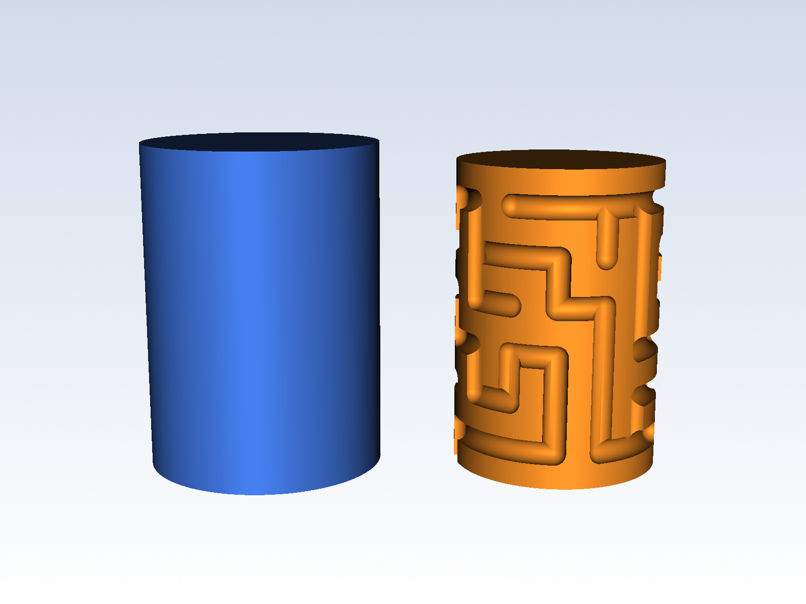

# Cylindrical Maze Puzzle Gift Box (seed 13305)

A parametric cylindrical maze puzzle: a hollow core with a maze cut into its surface,
and a sleeve with a pin on the inside. The box only opens once the maze is solved.



| File | Content |
| --- | --- |
| `maze_core.stl`, `maze_sleeve.stl` | ready to print, already oriented |
| `maze_core.step`, `maze_sleeve.step` | for editing in CAD |
| `maze_cadquery.py` | generates STEP + STL + `maze_params.json` |
| `render_previews.py` | renders `previews/*.png` (VTK) |
| `cults_upload.py` | publishes to Cults3D via the GraphQL API |

## Build

```
pip install cadquery vtk requests
python maze_cadquery.py
python render_previews.py
```

## Publishing to Cults3D

Cults downloads files and images from public URLs, so this repo is the host:
`https://raw.githubusercontent.com/<user>/<repo>/main/<path>`.

```
set CULTS_USER=...
set CULTS_API_KEY=...
python cults_upload.py --github <user>/<repo>          # checks only, sends nothing
python cults_upload.py --github <user>/<repo> --send   # publishes after confirmation
```

After any rebuild, commit and push the new files first: the upload script compares
the size of each public file with the local one and refuses to send if they differ.
